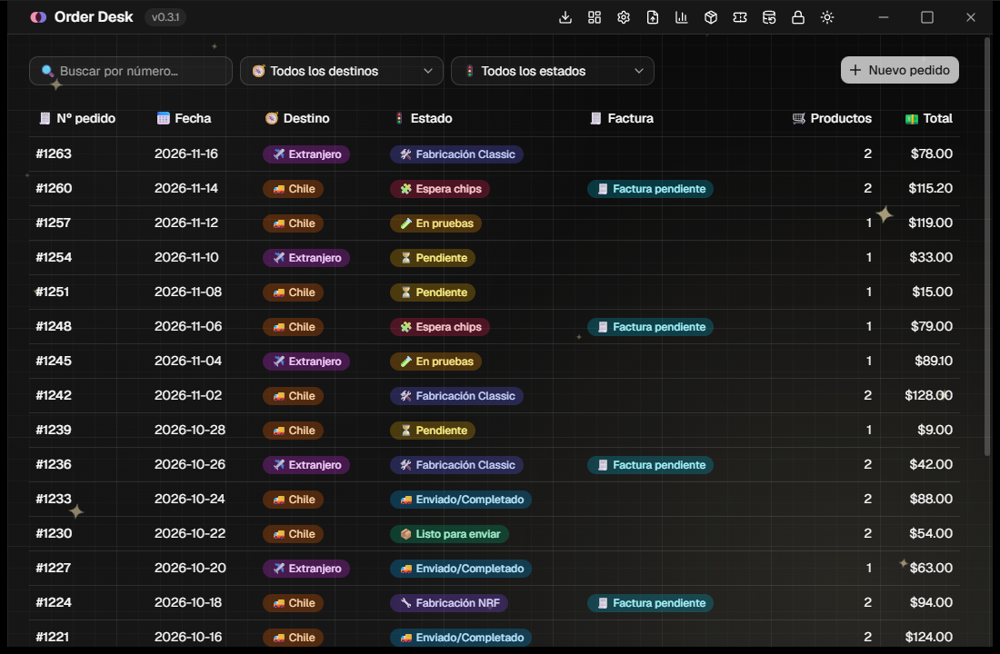
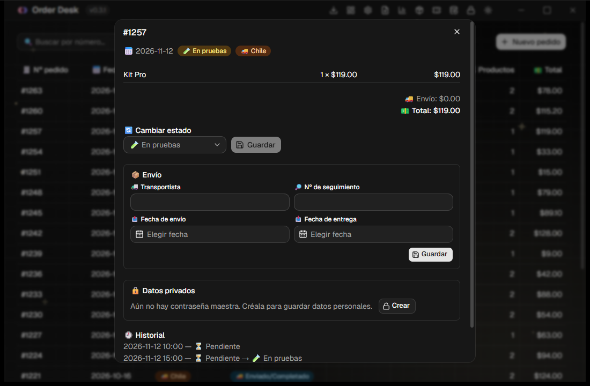
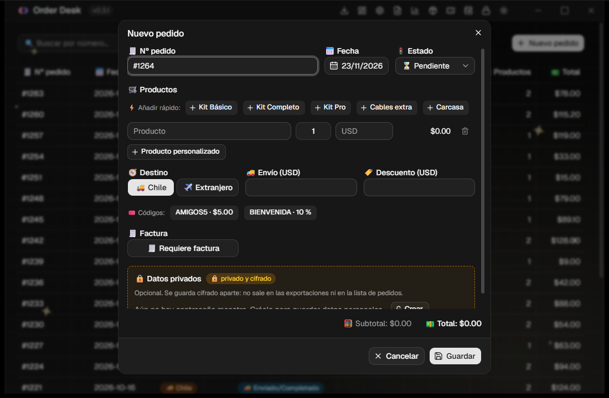
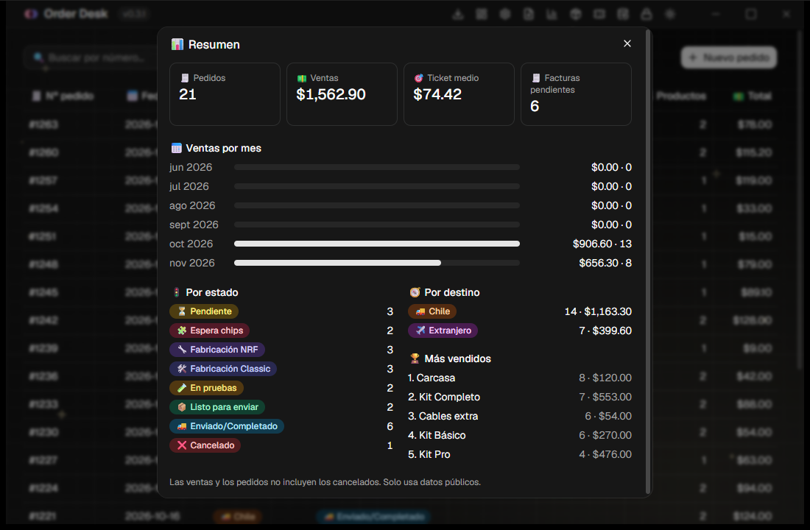
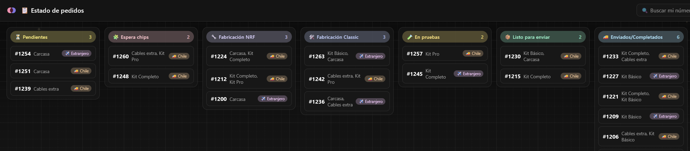

# Order Desk

Aplicación de escritorio para Windows, sin conexión a internet, para llevar el control de pedidos comerciales (pensada para unos 200–1.000). Todo se guarda en tu propio equipo.



## Qué puedes hacer

- **Pedidos**: número del pedido (`#1424`), fecha, destino (Chile o extranjero), productos, descuentos, coste de envío y seguimiento. Cada pedido guarda el historial de sus cambios de estado.
- **Estados de fabricación**: Pendiente, Espera chips, Fabricación NRF, Fabricación Classic, En pruebas, Listo para enviar, Enviado/Completado y Cancelado. Cada estado y destino tiene su propio color y emoji para leerlos de un vistazo.
- **Productos y códigos de descuento**: catálogo propio para rellenar los pedidos más rápido.
- **Estadísticas** mensuales de ventas.
- **Importar desde Excel**: carga una hoja con pedidos (número, kit y país), con vista previa antes de aplicar. Los pedidos nuevos se crean y los existentes se actualizan.
- **Tablero público**: página web con los pedidos agrupados por estado, para que los clientes sigan su avance. Se publica con un clic en un repositorio de GitHub Pages que eliges en la configuración. Solo muestra número de pedido, kit y destino.
- **Sección privada** con contraseña para los datos personales de los clientes. Se puede bloquear en cualquier momento y el resto de la aplicación sigue funcionando.
- **Exportar** a JSON o CSV (Excel), solo con datos públicos.
- **Copias de seguridad** cifradas, con restauración.
- **Actualizaciones automáticas** desde las [releases](../../releases) de este repositorio.

## Capturas

Todos los datos de las imágenes son inventados.

| Detalle de un pedido | Nuevo pedido |
| --- | --- |
|  |  |



Tablero público que ven los clientes:



## Instalación

Descarga el instalador `Order.Desk_X.Y.Z_x64-setup.exe` de la [última release](../../releases/latest) y ejecútalo. Después, la aplicación avisa sola cuando hay una versión nueva.

## Publicar el tablero

1. Crea un repositorio en GitHub y activa **Pages** (rama `main`, carpeta raíz).
2. Instala [git](https://git-scm.com/) e inicia sesión en GitHub en ese equipo.
3. En Order Desk pulsa el engranaje junto al botón del tablero y pega la dirección `https://github.com/usuario/repositorio`.
4. Pulsa el botón del tablero cada vez que quieras actualizarlo. La aplicación no guarda ninguna clave.

## Desarrollo

Stack: Tauri 2, React + TypeScript + Vite, Tailwind y shadcn/ui, Rust y SQLite.

Requisitos: Windows con Node.js, Rust y Visual Studio Build Tools. Los comandos que compilan Rust se anteponen con `scripts\cargo-env.cmd`; si hace falta, crea `scripts\cargo-env.local.cmd` con el `PATH` de Strawberry Perl.

```
npm install
scripts\cargo-env.cmd npm run tauri dev
npm test
scripts\cargo-env.cmd cargo test --manifest-path src-tauri\Cargo.toml
```

## Licencia

[MIT](LICENSE)
